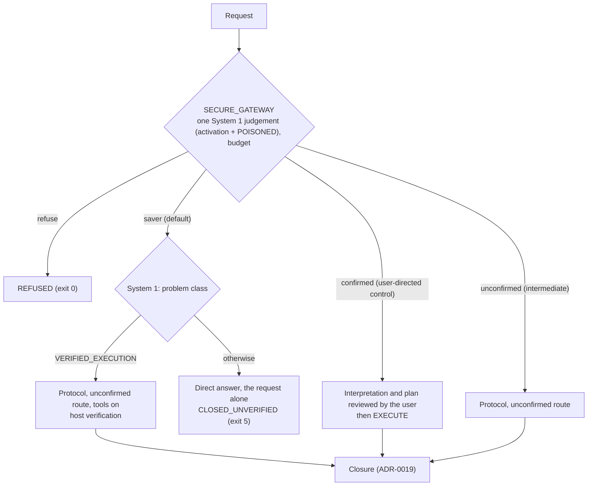

# ADR-0031: Default Configuration: Saver Mode, In-Call Tools, Low Reasoning

## Status
**Proposed.** The user's decision in L158: "Saver with tools enabled is the clear default", and "Low reasoning should unquestionably be the default". It was made on the user's condition, measured in L159: met on Cerebras, not met on the default provider order. Acceptance, and the provider order in decision 4, are the user's.

- Supersedes [ADR-0022](0022-default-reasoning-high-pre-execution.md)'s per-operation reasoning table, which L155 already retired in code: every gpt-oss operation runs at low.
- Replaces L94's standard default for the REPL and the API, the unconfirmed route, with saver mode.
- Turns on by default the in-call tools of [ADR-0029](0029-in-call-agent-tools.md), which are off by default today.
- Keeps [ADR-0019](0019-headless-waiting-input-exit-and-wire-tolerance.md)'s exit codes: a direct answer closes `CLOSED_UNVERIFIED` (exit 5).

## Context
The user's ranking (L158): **Saver > Confirmed > Unconfirmed > Control.**
- **Saver** is the default today: it beats Control on completion while staying competitive on speed and cost.
- **Confirmed** is the mode PDLt is built to win. Its stages give the user explicit control over interpretation, approach, inputs and outputs.
- **Unconfirmed** is an intermediate configuration. Its interpretation and approach are post hoc.
- **Control** is the evaluation baseline, not a product mode.

Recorded measurements (gpt-oss-120b, low reasoning, Tier D1 and structured output on; the targeted set is `prompts/TARGETED_MANIFEST.jsonl`):

| Ledger | Set | Saver | Unconfirmed | Confirmed | Control |
|---|---|---|---|---|---|
| L155 | targeted, 270 runs | 78.7% decided passes, 0 silent false positives | 70.2%, 12/47 | 62.5%, 15/48 | – |
| L157, tools off | targeted | 70.2%, 0 | – | – | 63.0% (direct 67.4%) |
| L157, tools on | targeted | 78.7%, 0; +0.089 [+0.000, +0.189] against Control | 66.7%, 13/45; +0.011 | 67.4%, 11/46; +0.022 | – |

L159 measured the 10 catalogue prompts System 1 classes VERIFIED_EXECUTION (01-01 to 01-07, 13-01, 13-02, 16-07), 3 repeats each, with saver's tools on:

| Arm | Graded passes | Silent false positives | Median time | Condition |
|---|---|---|---|---|
| Saver, Cerebras | 28/29 (96.6%) | 0 | 9.1 s | met |
| Saver, default order (Baseten, Crusoe) | 27/29 (93.1%) | 1 | 16.8 s | not met |
| Control, default order | 14/30 (46.7%) | – | 7.4 s | – |

The one silent false positive is 16-07, run 3, on the default order. The deliverable's program encodes a clue wrongly, and the host verified that the program printed its witness. That shows where the answer came from, not that it is correct (ADR-0030, known limit). Both MANUAL grades are correct on a spot check.

## Decision
1. **The default mode is saver** in the REPL (`--mode`) and in the API (`Session.open(mode=)`). The catalogue runner keeps its measurement default, the unconfirmed route, because its stage grading expects protocol closures.
2. **In-call tools are on by default** in every mode, and `--no-agent-tools` turns them off.
   - They act on saver's protocol branch and on the unconfirmed route's execution: `run_python` and the submission check.
   - The drafts and Bootstrap get their submission checks.
   - The confirmed route's EXECUTE gets no tool from ADR-0029's registry (L157).
3. **Every operation runs at low reasoning effort** (L155, L158).
4. **Provider order: open.**
   - **Measured:** saver met the condition with Cerebras first, and missed it on the default order by one host-verified false positive.
   - **Recorded constraint:** Cerebras, anywhere in the order, closes every free-form object in a JSON schema and drops the positive witness ([api_worker.py](../../src/pdl_taskmaster/providers/api_worker.py), `_default_provider_order`; PROVIDERS.md). With tools on, saver's execution carries its schema in the submission tool, and its witnesses survived: 22 host-verified closures in L159. The confirmed route's EXECUTE has no tools and is sent in JSON mode.
   - **Options:**
     - (a) Cerebras first for every call. This breaks the confirmed route's witness until its EXECUTE gets tools.
     - (b) Cerebras first for saver only, as a per-mode order.
     - (c) Keep Baseten, Crusoe, and accept the default-order result.
5. **The modes, as a flowchart** ([docs/routing.md](../routing.md) holds the routing design):

## Options considered
- **Keep the unconfirmed route as the default (L94).** At low reasoning it shows no measurable gain over Control (L157: +0.011), with 12 of 47 graded runs a silent false positive (L155).
- **Make Confirmed the default.** It is the strategic mode, but today it loses on every measure (L155). All 11 of its silent false positives in L157 are contract-checked closures (L140 (1)).
- **Higher reasoning effort.** ADR-0022's table scored better on the unconfirmed route: 82% against 70% of graded runs, one run per prompt (L155). It took 4.7 times as long, Bootstrap alone 50.8 s against 5.5 s. The user: low "unquestionably".
- **Saver with tools at low reasoning (chosen).**

## Consequences
- **Headless callers see exit 5 for most requests.** Every direct answer closes `CLOSED_UNVERIFIED` with the reason `direct_answer`; in L157, 86 to 88 of 90 saver runs did. Exit 0 then means a verified task closed by the protocol, or a published refusal.
- **Zero silent false positives is structural only for direct answers.** On verified tasks, a host-verified closure can still be wrong. The host runs the deliverable's program, and a wrong program gives a host-verified wrong answer (L159).
- **Latency.**
  - Saver on verified tasks: a median of 9.1 s on Cerebras (model calls 4.0 s; host verification and harness 4.6 s), 16.8 s on the default order.
  - Saver's direct answers: about 12 to 15 s on the default order (L157). On Cerebras they are unmeasured for saver; Control's call there is recorded at 1.0 to 2.0 s.
  - The user's expectation of 2 to 3 s would need the harness overhead and the three System 1 calls cut (L158).
- **The Confirmed priority (L158) remains.** Reduce its silent false positives (the contract-checked closure rule, L140 (1)) and give its EXECUTE in-call tools (an ADR-0029 amendment), keeping the control that sets it apart.
- **It changes what the provider receives:** tools on by default, and the provider order under options (a) or (b). L159's Cerebras arm is the live check for saver. The pre-merge catalogue check (`run_catalogue.py --fail-fast`) is still due.
