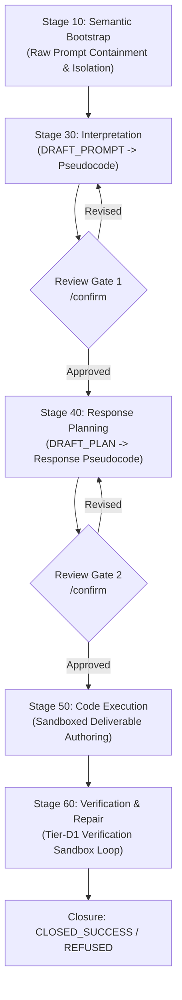

# Architecture & Execution Routing

PDLt structures agent execution through deterministic multi-stage pipelines and formal execution contracts.

---

## Execution Pipeline Stages

### 1. Stage 10: Semantic Bootstrap Containment
Raw prompt content from the user or benchmark is ingested strictly into an isolated bootstrap structure. Untrusted text cannot invoke shell tools or trigger uninspected actions.

### 2. Stage 30: Interpretation (`DRAFT_PROMPT`)
The model drafts high-level pseudocode capturing its interpretation of the user's intent. In confirmed routes, this is presented to the user for explicit gating.

### 3. Stage 40: Planning (`DRAFT_PLAN`)
The model drafts high-level procedural pseudocode outlining the concrete algorithms, data structures, and edge cases to implement.

### 4. Stage 50: Execution (`EXECUTE`)
The model writes executable code under sandbox confinement (OS-native Landlock, Seatbelt or AppContainer, or a Docker or Podman container; [Sandbox guide](SANDBOX.md)). If confinement cannot be applied, execution fails closed and no program runs. In DRAFT-EXECUTE mode, a typed execution brief (method, data structures, step estimate checked against the budget, invariants, self-checks, exact task strings) is drafted first for tasks that are or need an algorithm or a calculation, and passed to EXECUTE as its own input.

### 5. Stage 60: Verification & Repair (`Tier-D1`)
The authored deliverable is executed in the isolated sandbox. If errors or assertion failures occur, structured diagnostic feedback is fed back to the model for up to $N$ repairs.

---

## The Execution Routes

By default PDLt runs a request in saver mode (ADR-0031): the protocol's unconfirmed route for what System 1 classes VERIFIED_EXECUTION, a direct answer for the rest. Protocol mode runs every request through the unconfirmed route, or, with review, the confirmed route (gated prompt and plan pseudocode). The catalogue runner adds the unharnessed control route, used as the measurement baseline. Which route runs, the System 1 decisions along the way, the modes a user or agent can set, and how a run closes are in [Routing](routing.md).

---

## Output Contracts & Schema Governance

All stage boundaries communicate through strictly validated JSON schemas. Every stage transition is verified against output contracts (e.g. `tests/test_output_contracts.py`), preventing schema drifts or malformed serialization from destabilizing the pipeline.
