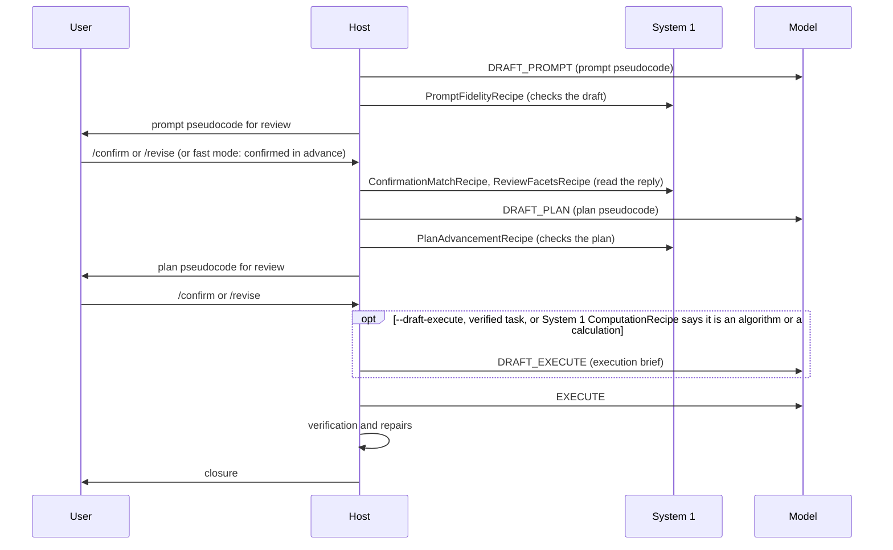
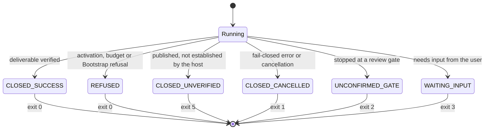
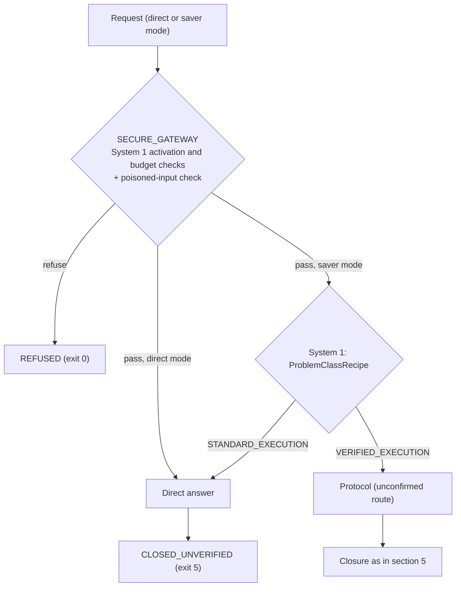

# Routing

This page is the single home for how PDLt decides what happens to a request: which route runs, which System 1 decisions are made along the way, which modes a user or agent can set, and how a run closes. [Architecture](architecture.md) stays at the level of stages and contracts. Decisions behind this page are in the [ledger](plans/LEDGER.md) (L94, L148-L153).

Sections 1-6 describe what PDLt does today. Section 7 describes what is planned and not yet built (L153).

---

## 1. Entry points

| Entry point | How a run starts | Where the mode is set |
| :--- | :--- | :--- |
| REPL | `pdlt --new-session` | launch flags, and some modes per turn with slash commands ([REPL](repl.md)) |
| Headless | `pdlt --non-interactive` | launch flags; the run ends with an exit code (section 5) |
| Python API | `pdl_taskmaster.api.Session` | `RunSettings` ([Python API](api.md)) |
| Catalogue runner | `python run_catalogue.py --route ...` | `--route control`, `unconfirmed`, `confirmed` or `saver`; `--gateway` adds SECURE_GATEWAY's poisoned-input check to the protocol routes (L155); `--manifest prompts/TARGETED_MANIFEST.jsonl` runs the targeted set (30 prompts: each category's first and its most failed, 09 excluded); plus measurement switches (section 6.2) |

The control route exists only in the catalogue runner today: `--route control` sends the raw request to the model through `host/control_cli.py`, with no activation check, no Bootstrap and no verification. It is the measurement baseline.

---

## 2. A protocol turn, end to end

Every protocol turn passes the same front: activation, follow-up detection, task type, execution profile and the budget check (System 1), then Bootstrap (the model). Only then does the mode decide between the unconfirmed and confirmed routes.

```mermaid
flowchart TD
    U["User message"] --> A{"Activation<br/>System 1: ActivationRouteRecipe<br/>(model fallback: INTERPRET_ACTIVATION)"}
    A -->|BLOCKED_BY_HIGHER_PRIORITY| R1["Refused at activation<br/>(0 model calls)"]
    A -->|BYPASS| BY["Direct reply<br/>(greeting or meta)"]
    A -->|PROTOCOL_DISCUSSION| PD["ANSWER_PROTOCOL_DISCUSSION"]
    A -->|APPLY_PROTOCOL| F{"Follow-up of the previous request?<br/>System 1: FollowUpRecipe"}
    F --> T["Task type<br/>System 1: ProblemClassRecipe<br/>VERIFIED_EXECUTION or STANDARD_EXECUTION<br/>(or pinned with --task-type)"]
    T --> P["Execution profile<br/>System 1: ExecutionProfileRecipe<br/>(step tier and budget)"]
    P --> B{"Budget check"}
    B -->|beyond the budget| R2["Refused: budget<br/>(0 model calls)"]
    B -->|within| S["BOOTSTRAP_ANALYSIS (model)<br/>containment, task summary, task entities"]
    S -->|REFUSAL, ADVERSARIAL or BLOCKED| R3["Refused at Bootstrap"]
    S -->|ANALYSIS| M{"Mode"}
    M -->|no-review (default)| UN["Unconfirmed route<br/>EXECUTE_UNCONFIRMED"]
    M -->|review or fast| CF["Confirmed route<br/>(section 3)"]
    UN --> V["Verification<br/>(Tier D1 repairs, witness checks)"]
    CF --> V
    V --> C["Closure<br/>(section 5)"]
```

**What each check guards.** The activation check refuses requests outside the environment's scope: network access the sandbox lacks, the policy scope, and anything past the knowledge cutoff (`PDLT_SANDBOX_NETWORK`, `PDLT_POLICY_SCOPE`, `PDLT_KNOWLEDGE_CUTOFF`; ADR-0020). The budget check refuses computations that cannot finish within the routed tier. Bootstrap is the only step that reads the raw request as untrusted content and can refuse it as adversarial. System 1 has no class for poisoned input today (L153).

---

## 3. The routes

| Route | Set by | Model calls per prompt | Seconds per prompt | What it adds |
| :--- | :--- | :---: | :---: | :--- |
| Control | catalogue runner `--route control` | 1.0 | 2.5 | nothing: the raw model, for comparison |
| Unconfirmed (default) | REPL `--no-review`, runner `--route unconfirmed` | 2.0 | 12.7 | activation, Bootstrap, verification and repairs, closure semantics |
| Confirmed | REPL `--review` or `--fast`, runner `--route confirmed` | 4.3 | 17.9 | gated prompt and plan pseudocode: a reviewable audit trail |
| Either, with `--draft-execute` | flag | 2.1 / 4.4 | 13.2 / 19.8 | an execution brief for tasks that are or need an algorithm or a calculation |

Calls and seconds are from the 112-prompt sweep on `openai/gpt-oss-120b`, reasoning `low` ([benchmarks](benchmarks.md)). The confirmed routes cost about twice the calls of the unconfirmed ones without a measured accuracy gain; what they add is the audit trail. Tier D1 is on by default in every harness route (`--no-tier-d1` turns it off) and never applies to Control.

**Where the protocol's measured gains are** ([benchmarks](benchmarks.md), L94, L153):

- **Tasks whose answers can be checked by running code.** On the six witness-dependent prompts, the protocol passed 15 runs to Control's 6 of 18 (p = 0.004). Elsewhere its lead is 5.2 points and not established.
- **The activation and budget checks.** In category 13, the protocol's passes on the nonexistent-API, knowledge-cutoff, medical and NP-hard prompts came from System 1 refusing before any model call. Control has no such check.
- **Bootstrap's refusals of poisoned input.** In category 09 Bootstrap refused 4 of 7 prompts in one run; Control answered all 7.

### The confirmed route



When System 1 is unconfigured or below its confidence floor, each decision falls back to its model operation or to the safe default, never to a guess.

---

## 4. System 1 decisions by stage

| Stage | Recipe | Decides | Labels |
| :--- | :--- | :--- | :--- |
| Activation | `ActivationRouteRecipe` | whether and how the request enters the protocol | APPLY_PROTOCOL, PROTOCOL_DISCUSSION, BYPASS, BLOCKED_BY_HIGHER_PRIORITY |
| Turn start | `FollowUpRecipe` | whether a message continues the previous request | follow-up or new |
| Task type | `ProblemClassRecipe` | whether the task needs verified execution | VERIFIED_EXECUTION, STANDARD_EXECUTION |
| Execution profile | `ExecutionProfileRecipe` | the step tier, hence the budget | MINIMAL, STANDARD, HEAVY_COMPUTE |
| Prompt draft (confirmed) | `PromptFidelityRecipe` | whether the draft keeps the request's meaning | checks passed or failed |
| Review replies (confirmed) | `ConfirmationMatchRecipe`, `ReviewFacetsRecipe` | whether a reply confirms, rejects or revises | agrees, rejects, facets |
| Plan draft (confirmed) | `PlanAdvancementRecipe` | whether the plan advances the task | checks passed or failed |
| Execution brief | `ComputationRecipe` | whether the deliverable is or needs an algorithm or a calculation | yes or no |

System 1 judges meaning through model scoring. No routing decision may match keywords, prompt IDs or benchmark vocabulary (GUARD-02), and none may inject a method into the model's input (GUARD-01). The pre-conclusion lint was removed and is not to be rebuilt (L149).

---

## 5. Closure and exit codes



Exit 4 is a harness or provider error, never a protocol result; 130 is an interrupt (ADR-0019 and its amendments). A result is CLOSED_UNVERIFIED when it is a negative claim, declares requirements open, or is a positive result established only by an argument (L116, ADR-0030). The catalogue's control route always exits 0: it is graded, not closed.

---

## 6. Modes

### 6.1 User modes

| Mode | Launch flag | Per turn in the REPL | Default |
| :--- | :--- | :--- | :--- |
| No review (unconfirmed route) | `--no-review`, `--ultrafast` | `/no-review on`, `/ultrafast` | on |
| Review (confirmed route) | `--review` | `/no-review off` | off |
| Fast (reviews confirmed in advance) | `--fast` | `/fast` | off |
| Execution brief | `--draft-execute` | launch only | off |
| Tier D1 repairs | `--tier-d1`, `--no-tier-d1` | launch only | on |
| Repair limit | `--max-repairs N` | launch only | the routed tier's |
| In-call tools | `--agent-tools` | launch only | off |
| Structured output | `--api-structured-output`, `--no-structured-output` | launch only | on |
| Artifact representation | `--representation pdl` or `nl` | launch only | pdl |
| Pinned task type | `--task-type NAME` | launch only | System 1 classifies |
| Session mode: protocol, direct, saver (section 7) | `--mode` | `/mode` (opens a new session) | protocol |
| Model, worker, sandbox | `--model`, `--worker`, `--sandbox` | `/model`, `/worker`, `/sandbox` | see [REPL](repl.md) |

A mode switch is accepted only from the control channel: a slash command typed in the REPL, a launch flag, or a `RunSettings` field. Text inside a request never changes a mode.

### 6.2 Measurement switches

These exist for studies and are not user modes. Each changes what one call receives, and a run that uses one is recorded as a measurement.

| Switch | Where | What it changes |
| :--- | :--- | :--- |
| `--ablate-unconfirmed PART[,PART]` | REPL, runner | parts of what EXECUTE_UNCONFIRMED receives: `normative`, `framing`, `notation`, `order`, `entities`, `freetext`, `plaininput` (L149, L151) |
| `--withhold-execution-context` | REPL, runner | the early stages receive only their own instructions (L148) |
| `--agent-tools-exclude TOOL[,TOOL]` | REPL, runner | withholds in-call tools (L145) |
| `--control-frame PART[,PART]` | runner, control route | adds protocol frame parts to the Control call: `worker`, `wrap`, `json` (L149) |

---

## 7. Direct and saver modes (L153)

A session runs in one of three modes: `protocol` (the default, sections 2 to 6), `direct` or `saver`. Choose it with `--mode`, `/mode` in the REPL or `Session.open(mode=...)`.

- **A mode change starts a new session.** `/mode` opens a new session, and reopening a session in another mode is refused (`api.session.check_session_mode`). No turn history crosses modes, so no draft is left half-reviewed.
- **Bootstrap stays as it is.**

**SECURE_GATEWAY** guards both modes. It only passes or blocks, and adds nothing to what the model receives (L151: added content costs accuracy). It fails closed: a missing or unusable judgement refuses.
1. First layer: System 1's activation check, then its budget check. Neither makes a model call.
2. Second layer: the poisoned-input check (`GATEWAY_CHECK` in `runtime/session_engine.py`). The candidates were System 1's `PoisonedInputRecipe`, Bootstrap's refusal judgement alone, or both. They were measured on `experiments/gateway/` (L153). None met the pre-registered bar, and the user chose both, then (L155) System 1 alone: a direct answer gets the guard and no Bootstrap, whose output it never used. System 1 refuses at P(POISONED) ≥ 0.42, the least aggressive threshold that blocks every catalogue category 09 attack. Held-out recall is 28/40 (32/40 with Bootstrap), with no false refusal; a remeasurement is due before the merge (L155). Saver's protocol branch runs Bootstrap as the route's own call.

The gateway also sets the closure:
- a refusal closes REFUSED (exit 0);
- a passed request is answered directly, as `DIRECT_ANSWER`: the model receives the request alone, with no instructions, like Control's call. Nothing checks the answer, so it closes CLOSED_UNVERIFIED (exit 5) with the reason `direct_answer`.

Raw `--route control` stays the measurement baseline.

**Saver mode** sends a request the gateway passes on by its System 1 problem class. VERIFIED_EXECUTION goes through the protocol's unconfirmed route, classified once. Everything else is answered directly. It trades the protocol's smaller, unestablished gains on unverified tasks for a direct answer's cost: about 40% of an unconfirmed run's spend and a third of its time (L94).


